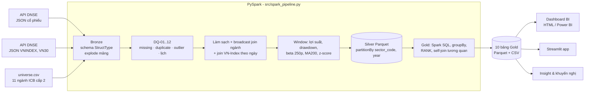

# Phân tích hiệu quả, rủi ro & dòng tiền 11 ngành trên TTCK Việt Nam bằng PySpark

**Môn:** Phân tích dữ liệu lớn trong đầu tư và kinh doanh — Đề tài cuối kỳ · **Nhóm 01**

Pipeline thống nhất theo đúng đề: **Data (API DNSE) → PySpark → Analytics → Dashboard BI → Streamlit → Insight/Khuyến nghị**.

## 1. Bài toán và câu hỏi phân tích

Nhà đầu tư phân bổ vốn theo ngành cần biết ngành nào đáng nắm giữ dài hạn, ngành nào phòng thủ,
dòng tiền đang dịch chuyển về đâu và đa dạng hóa theo ngành có thực sự giảm rủi ro không.

| # | Câu hỏi | KPI / kỹ thuật | Bảng Gold |
|---|---|---|---|
| Q1 | Ngành nào có lợi suất điều chỉnh rủi ro tốt nhất so với VN-Index, thứ hạng có ổn định qua các năm? | CAGR, biến động, Sharpe, Sortino, MaxDD; xếp hạng theo năm (window `RANK`) | `sector_kpi`, `sector_yearly` |
| Q2 | Ngành nào phòng thủ / tấn công? | Beta, upside/downside capture, lợi suất vượt VN-Index khi VN-Index trên/dưới MA200 | `sector_kpi`, `sector_regime` |
| Q3 | Dòng tiền dịch chuyển giữa các ngành ra sao? | Giá trị giao dịch, tỷ trọng theo quý, thay đổi QoQ | `liquidity_quarterly` |
| Q4 | Cặp ngành nào giúp đa dạng hóa tốt nhất? | Ma trận tương quan lợi suất ngày (self-join) | `sector_corr` |
| Q5 | Trong từng ngành, mã nào dẫn dắt, mức phân hóa ra sao? | KPI từng mã, lợi suất tháng | `ticker_kpi`, `ticker_monthly` |

## 2. Dữ liệu

| Nguồn | Nội dung | Định dạng |
|---|---|---|
| API DNSE `services.entrade.com.vn/chart-api/v2/ohlcs/stock` | OHLCV ngày của **81 mã** thuộc **11 ngành ICB cấp 2** (6–8 mã/ngành) | JSON, 1 file / mã / năm |
| API DNSE `…/ohlcs/index` | VNINDEX, VN30 (lấy sớm hơn ~400 ngày để có MA200) | JSON |
| `config/universe.csv` | Danh mục mã – sàn – mã ICB cấp 2 – tên ngành | CSV |

- **Giai đoạn:** 01/01/2017 → ngày chạy (~10 năm). Đổi trong `src/config.py` hoặc biến môi trường `START`, `END`.
- **Quy mô ước tính:** 81 mã × ~2.450 phiên ≈ 180.000–195.000 dòng (mã niêm yết muộn có ít phiên hơn) — vượt mức khuyến nghị 100.000 dòng. Con số thực tế in ra sau khi chạy `fetch_dnse.py` và ghi trong `reports/pipeline_metrics.json`.
- **Đơn vị:** giá theo nghìn đồng, khối lượng theo cổ phiếu; giá trị giao dịch quy đổi ra tỷ đồng.
- **11 ngành:** Ngân hàng · Dịch vụ tài chính · Bất động sản · Xây dựng & Vật liệu · Tài nguyên cơ bản · Hóa chất · Thực phẩm & Đồ uống · Bán lẻ · Dầu khí · Điện, nước & xăng dầu khí đốt · Hàng & Dịch vụ công nghiệp.
  Phân ngành theo ICB cấp 2 (supersector); **nhóm nên đối chiếu lại** với bảng phân ngành ICB trên HOSE/HNX trước khi nộp. Muốn thay/thêm mã chỉ cần sửa `config/universe.csv`.

**Vì sao dùng Spark:** dữ liệu gồm ~830 file JSON (nhiều nguồn, nhiều năm) cần đọc song song, làm phẳng mảng,
khử trùng lặp và rất nhiều phép **window theo mã × ngày** (lợi suất, drawdown, beta trượt 250 phiên, z-score) +
**self-join** theo ngày. Cùng mã nguồn chạy được trên cụm khi mở rộng sang toàn bộ ~1.600 mã HOSE/HNX/UPCoM hoặc dữ liệu phút.

## 3. Kiến trúc pipeline



## 4. Cấu trúc thư mục

```
├── config/universe.csv          # danh mục 81 mã / 11 ngành
├── src/
│   ├── config.py                # đường dẫn, giai đoạn, tham số (rf, biên độ giá…)
│   ├── check_env.py             # tự chẩn đoán môi trường, in lỗi + cách sửa
│   ├── fetch_dnse.py            # B1: gọi API DNSE -> data/raw/dnse (Bronze)
│   ├── spark_pipeline.py        # B2: PySpark Bronze -> Silver -> Gold
│   ├── build_dashboard.py       # B3: dashboard BI HTML + reports/insights_auto.md
│   └── insights.py              # sinh insight từ số liệu Gold (dùng chung)
├── app/streamlit_app.py         # B4: ứng dụng Streamlit (7 tab)
├── dashboard/                   # BI_Dashboard_Nganh_VN.html (sinh ra sau khi chạy)
├── data/{raw,silver,gold}/      # sinh ra khi chạy (không nộp raw nếu quá nặng)
├── reports/                     # pipeline_metrics.json, spark_plan_*.txt, insights_auto.md
├── docs/                        # PHAN_BIEN.md · POWER_BI.md · DAN_Y_BAO_CAO.md
├── tests/test_pipeline.py       # pytest cho các phép biến đổi Spark
├── notebooks/Chay_tren_Colab.ipynb  # chạy toàn bộ trên Google Colab
└── run_all.sh / run_all.bat
```

## 5. Cách chạy

Yêu cầu: Python 3.10–3.12, **Java 17** (`java -version`), Internet tới `services.entrade.com.vn`.

Cách nhanh: chạy `run_all.bat` (Windows, double-click) hoặc `./run_all.sh` (Mac/Linux) — bước 0 tự kiểm tra
Python, thư viện, Java, winutils, kết nối DNSE và Spark, in ra **[LOI] + cách sửa**. Chỉ kiểm tra:
`python src/check_env.py`.

Chạy từng bước:
```bash
pip install -r requirements.txt
python src/check_env.py            # kiểm tra môi trường
python src/fetch_dnse.py           # ~3–6 phút; chạy lại sẽ chỉ tải bù năm lỗi
python src/spark_pipeline.py       # ~1–3 phút trên laptop
python src/build_dashboard.py      # sinh dashboard + insight
pytest -q                          # 3 test cho logic Spark
streamlit run app/streamlit_app.py
```

**Windows:** Spark cần `winutils.exe` để ghi Parquet. Cách nhanh nhất là chạy trong **WSL2** hoặc **Google Colab**.
Nếu chạy Windows gốc: tải `winutils.exe` + `hadoop.dll` (Hadoop 3.3), đặt vào `C:\hadoop\bin`, set `HADOOP_HOME=C:\hadoop` và thêm `%HADOOP_HOME%\bin` vào `PATH`.

**Google Colab (không cần cài Java/winutils):** mở colab.research.google.com → *File → Upload notebook* →
chọn `notebooks/Chay_tren_Colab.ipynb`, rồi chạy lần lượt từng ô (ô 1 yêu cầu upload file zip project).
Nếu API DNSE chặn máy chủ Colab (ở nước ngoài): chạy `python src/fetch_dnse.py` trên máy bạn (chỉ cần
`pip install requests`, không cần Java), nén thư mục `data/raw` và upload ở ô 4b.

## 6. Đầu ra

| File | Dùng cho |
|---|---|
| `data/silver/daily_panel/` | Bảng giao dịch sạch đầy đủ cờ chất lượng, Parquet phân vùng |
| `data/gold/csv/*.csv` (+ `parquet/`) | 10 bảng KPI + `data_quality_report` → Power BI, Streamlit |
| `dashboard/BI_Dashboard_Nganh_VN.html` | Dashboard BI tương tác, mở bằng trình duyệt, không cần mạng |
| `reports/insights_auto.md` | Insight & khuyến nghị sinh từ số liệu → dán vào Chương 4, 6 |
| `reports/pipeline_metrics.json` | Số dòng qua từng bước, kết quả DQ → Chương 3 |
| `reports/spark_plan_sector_kpi.txt` | Physical plan (BroadcastHashJoin, Window, Exchange) → minh họa Chương 3 |

## 7. Đối chiếu rubric

| Tiêu chí | Đáp ứng ở đâu |
|---|---|
| Bài toán & dữ liệu (10) | Mục 1–2; nguồn API kiểm chứng được (`fetch_log.csv` có URL từng lần gọi) |
| Pipeline PySpark (25) | `spark_pipeline.py`: đọc đa nguồn có schema, DQ missing/duplicate/outlier, filter, transform, broadcast join + join theo ngày + self-join, groupBy, Spark SQL, window (`lag`, `rowsBetween`, `RANK`, `row_number`), ghi Parquet phân vùng + CSV |
| Phân tích & insight (20) | 5 câu hỏi Q1–Q5, insight + khuyến nghị sinh từ dữ liệu |
| Dashboard BI (15) | Dashboard HTML: 5 thẻ KPI, 4 bộ lọc, 7 visual liên kết, bảng; hướng dẫn Power BI trong `docs/POWER_BI.md` |
| Streamlit (15) | 7 tab, bộ lọc giai đoạn/ngành tính lại KPI, insight từng câu hỏi, tab chất lượng dữ liệu |
| Báo cáo & thuyết trình (10) | `docs/DAN_Y_BAO_CAO.md` |
| Tái lập & sáng tạo (5) | requirements, README, `pytest`, chạy được trên PySpark 3.5 và 4.x với kết quả giống nhau |

## 8. Phân công & GenAI

Xem bảng mẫu trong `docs/DAN_Y_BAO_CAO.md` (Phụ lục). Bản tái cấu trúc này có sử dụng **Claude (Anthropic)** để
rà soát lỗi bài cũ và viết lại mã nguồn — nhóm cần ghi rõ trong mục khai báo GenAI và phải hiểu, giải thích được từng bước.

> Trước khi nộp: đổi tên file nén theo quy định `Nhom01_DeTaiCK_HoTen_MaSV` (nhóm trưởng nộp).
