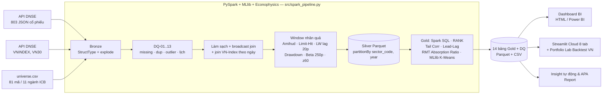

# Phân tích hiệu quả, rủi ro & dòng tiền 11 ngành trên TTCK Việt Nam bằng PySpark

**Học phần:** Phân tích dữ liệu lớn trong đầu tư và kinh doanh — Đề tài cuối kỳ  
**Trường:** Đại học Kinh tế TP. Hồ Chí Minh (UEH) — Trường Kinh tế, Luật và Quản lý Nhà nước  
**Giảng viên hướng dẫn:** TS. Đỗ Như Tài · **Nhóm thực hiện:** Nhóm 01 (5 thành viên)

- **Ứng dụng Streamlit trực tuyến (Live Cloud):** https://nhom01bigdatanganhvn.streamlit.app/
- **Kho mã nguồn (GitHub):** https://github.com/N2PHL/Nhom01_BigData_NganhVN

Pipeline thống nhất theo đúng yêu cầu đề tài: **Data (API DNSE) → PySpark (+ MLlib & Econophysics) → 14 bảng Gold → Dashboard BI → Streamlit 8 tab (Cloud + Portfolio Lab) → Insight & Khuyến nghị**.

---

## 1. Thành viên Nhóm 01 & Phân công công việc

| STT | Họ và Tên | MSSV | Phần việc chính | File phụ trách chính | Đóng góp |
|---:|---|---|---|---|---:|
| 1 | **Phan Đình Hồng Lĩnh** *(Nhóm trưởng)* | `33241026138` | Kiến trúc tổng thể PySpark, mô hình hóa Econophysics (RMT Absorption Ratio), PySpark MLlib K-Means, Portfolio Lab Backtest, kiểm thử tự động & triển khai Streamlit Cloud | `src/spark_pipeline.py`, `app/streamlit_app.py`, `tests/test_pipeline.py` | 20% |
| 2 | **Phạm Tuấn Hùng** | `33241026153` | Thu thập & kiểm chứng API DNSE (803 file JSON, `fetch_log.csv`), xây dựng danh mục 81 mã / 11 ngành ICB cấp 2, thực thi 13 quy tắc `DQ-01..13` & chẩn đoán môi trường | `src/fetch_dnse.py`, `config/universe.csv`, `src/config.py`, `src/check_env.py` | 20% |
| 3 | **Dương Tuyết Ngọc** | `33241026122` | Phân tích Q1 (Hiệu quả, Size Effect EW vs LW, CVaR 95%, Time-to-Recovery, Amihud) & Q2 (Beta, Capture, MA200, cụm MLlib Hoảng loạn); sinh insight tự động | `src/insights.py`, `reports/insights_auto.md` | 20% |
| 4 | **Nguyễn Lê Thảo Nhi** | `33241026064` | Phân tích Q3 (Dòng tiền & Lead–Lag Q1–Q5), Q4 (Tương quan tĩnh & Tail Dependence) & Q5 (Phân hóa nội ngành); Dashboard BI HTML & hướng dẫn Power BI | `src/build_dashboard.py`, `dashboard/BI_Dashboard_Nganh_VN.html`, `docs/POWER_BI.md` | 20% |
| 5 | **Lê Thị Như Phước** | `33241026238` | Tổng hợp cơ sở lý thuyết tài chính & chuẩn hóa trích dẫn APA 7th (22 tài liệu), biên tập Báo cáo chuẩn UEH, thiết kế Slide 17 trang & bộ câu hỏi phản biện | Báo cáo cuối kỳ (`.docx`/`.pdf`), Slide (`.pptx`), `docs/PHAN_BIEN.md`, `README.md` | 20% |

---

## 2. Bài toán và 5 câu hỏi phân tích

Nhà đầu tư phân bổ vốn theo ngành trên thị trường chứng khoán Việt Nam cần đánh giá đồng thời hiệu quả điều chỉnh rủi ro (có kiểm chứng hiệu ứng quy mô và rủi ro đuôi), hành vi phòng thủ/tấn công theo chế độ thị trường, tính dẫn dắt của dòng tiền, mức độ suy giảm đa dạng hóa khi khủng hoảng, và hiệu quả thực tế sau chi phí giao dịch & thuế.

| # | Câu hỏi phân tích | KPI & Kỹ thuật định lượng (PySpark / MLlib / Econophysics) | Bảng Gold |
|---|---|---|---|
| **Q1** | Ngành nào có lợi suất điều chỉnh rủi ro tốt nhất so với VN-Index, thứ hạng có ổn định qua các năm và có bị chi phối bởi Size Effect không? | CAGR (**EW & LW trễ 20p**), Biến động, Sharpe, Sortino, **Calmar**, MaxDD, **CVaR 95%**, Skewness/Kurtosis, **Time-to-Recovery**, **Amihud Illiquidity**, `RANK()` theo năm | `sector_kpi`, `sector_yearly`, `sector_daily` |
| **Q2** | Ngành nào phòng thủ / tấn công theo chu kỳ và trạng thái thị trường? | Beta, Upside/Downside Capture, chế độ **MA200**, phân cụm không giám sát **PySpark MLlib K-Means (3 chế độ)**, **tần suất chạm biên độ trần/sàn** | `sector_kpi`, `sector_regime`, `ml_regime_sector`, `systemic_risk_daily` |
| **Q3** | Dòng tiền dịch chuyển giữa các ngành ra sao; đột biến dòng tiền là Smart Money dẫn dắt hay FOMO đu đỉnh? | Giá trị giao dịch, tỷ trọng theo quý, thay đổi QoQ, **kiểm định Lead–Lag** (`flow_z60` trễ 60p vs lợi suất 20p & 60p sau theo 5 phân vị `ntile(5)`) | `liquidity_quarterly`, `flow_lead_lag` |
| **Q4** | Các ngành tương quan đến đâu lúc bình thường vs khi khủng hoảng; rủi ro hệ thống tích tụ khi nào? | Ma trận tương quan Pearson (self-join), **Conditional Tail Correlation** (`VN-Index > −1,5%` vs `≤ −1,5%`), **Absorption Ratio** (Random Matrix Theory, trượt 120 phiên) | `sector_corr`, `sector_corr_regime`, `systemic_risk_daily` |
| **Q5** | Trong từng ngành, mã nào dẫn dắt, mức phân hóa nội ngành ra sao? | KPI từng mã (Sharpe, Calmar, CVaR 95%, Time-to-Recovery, Amihud, chênh lệch CAGR nội ngành), lợi suất tháng | `ticker_kpi`, `ticker_monthly` |
| **Lab** | Các chiến lược phân bổ ngành có hiệu quả thực tế sau phí & thuế TTCK Việt Nam không? | **Portfolio Lab Backtest** (không look-ahead `shift(1)`, phí + thuế bán `0,25%/chiều`): Equal-Weight, Risk Parity (Inverse Vol 60p), Regime MA200, Regime MLlib | `app/streamlit_app.py` (Tab 7) |

---

## 3. Dữ liệu & Lý do sử dụng PySpark

| Nguồn | Nội dung | Định dạng | Quy mô thực tế |
|---|---|---|---|
| API DNSE `services.entrade.com.vn/chart-api/v2/ohlcs/stock` | OHLCV ngày của **81 mã** thuộc **11 ngành ICB cấp 2** (6–8 mã/ngành) | JSON (1 file/mã/năm) | **803 file**, **196.693 dòng** thô → **196.609 dòng** Silver sạch |
| API DNSE `…/ohlcs/index` | Chỉ số `VNINDEX`, `VN30` (lấy sớm hơn 400 ngày để đủ MA200) | JSON | **2.708 dòng** (`2.433` phiên trong giai đoạn chính) |
| `config/universe.csv` | Danh mục mã – doanh nghiệp – sàn (HOSE/HNX/UPCoM) – mã ICB cấp 2 – tên ngành | CSV UTF-8 | **81 mã**, **11 ngành** |

- **Giai đoạn dữ liệu:** `03/01/2017 – 20/11/2026` (~10 năm; tùy chỉnh qua `src/config.py` hoặc biến môi trường `START`, `END`).
- **Đơn vị & kiểm chứng:** Giá theo nghìn đồng (đã điều chỉnh sự kiện quyền), khối lượng theo cổ phiếu, giá trị giao dịch quy đổi tỷ đồng. Toàn bộ lịch sử gọi API được ghi trong `data/raw/dnse/fetch_log.csv`.
- **Vì sao dùng PySpark:** Đọc song song **803 file JSON** đa nguồn với `StructType` tường minh và `explode`, chạy **13 quy tắc kiểm tra chất lượng dữ liệu (`DQ-01..13`)**, thực thi **67 BroadcastHashJoin**, **611 toán tử Window** (lợi suất, Amihud, chạm trần/sàn, trọng số thanh khoản trễ 20p, CVaR 95%, Time-to-Recovery, Beta 250p, z-score 60p, Lead–Lag 20p/60p), **self-join** tương quan 11×11, và huấn luyện **PySpark MLlib K-Means** phân cụm chế độ thị trường. Cùng mã nguồn sẵn sàng mở rộng trên cụm Spark cho toàn thị trường (~1.600 mã) hoặc dữ liệu intraday.

---

## 4. Kiến trúc pipeline



---

## 5. Kết quả & Phát hiện nổi bật (01/2017–11/2026)

1. **Hiệu quả, Size Effect & Rủi ro đuôi (Q1):**
   - Trên rổ bình quân đều (EW), **9/11 ngành** có CAGR vượt VN-Index (`9,9%`), dẫn đầu là **Bán lẻ** (`Sharpe 0,77; CAGR 20,7%`) và **Hàng & Dịch vụ công nghiệp** (`0,77; 19,0%`).
   - Khi kiểm chứng Size Effect bằng rổ **gia quyền thanh khoản (LW, lag 20p)**, số ngành vượt VN-Index giảm còn **7/11**; chênh lệch mạnh nhất ở **Thực phẩm & Đồ uống** (**EW 12,0% → LW 2,0%**), trong khi **Ngân hàng** đạt **Sharpe LW cao nhất (`0,61`)**, **Calmar cao nhất (`0,42`)** và độ kém thanh khoản **Amihud thấp nhất (`0,000101`)**.
   - **100% ngành có Skewness âm và Excess Kurtosis dương** (`+1,80` đến `+4,83`); CVaR 95% sâu nhất ở **Dầu khí** (`−6,0%/phiên`), thời gian chìm dưới đỉnh lâu nhất ở **Tài nguyên cơ bản** (`1.262` phiên ≈ 5 năm).
2. **Phòng thủ / Tấn công & PySpark MLlib K-Means (Q2):**
   - Dưới MA200, **Điện, nước & khí đốt** (`beta 0,67`) vượt VN-Index `+27,9%/năm`; trên MA200, **Dịch vụ tài chính** (`beta 1,45`) vượt `+27,1%/năm` nhưng chạm biên độ trần/sàn nhiều nhất (`4,90%` số phiên).
   - Phân cụm **PySpark MLlib K-Means (k=3)** tách 3 trạng thái (*Hoảng loạn 487p · Tích lũy 868p · Tăng bền vững 958p*): trong cụm *Hoảng loạn*, **Hàng & Dịch vụ công nghiệp** phòng thủ tốt nhất (`+30,8%/năm`), còn **Dịch vụ tài chính** giảm mạnh nhất (`−22,6%/năm`).
3. **Dòng tiền & Lead–Lag (Q3):**
   - **Ngân hàng** dẫn đầu thanh khoản (`23,3%` quý IV/2026); 4 quý 2026 **Dầu khí** hút thêm `+4,8 điểm %` trong khi **Dịch vụ tài chính** giảm `−4,8 điểm %`.
   - Kiểm định Lead–Lag (`flow_z60` không look-ahead): nhóm **Q5 (đột biến dòng tiền)** cho lợi suất 20p và 60p sau cao gấp đôi nhóm **Q1 (cạn thanh khoản)** (**+2,3% vs +1,0%** và **+5,9% vs +3,0%**) → xác nhận hiệu ứng **Smart Money dẫn dắt theo sóng ngành**.
4. **Đa dạng hóa, Tail Dependence & RMT (Q4):**
   - Tương quan trung bình toàn giai đoạn là `0,62`, nhưng nhảy từ **`0,46`** (phiên bình thường) lên **`0,60`** khi VN-Index giảm sốc (`≤ −1,5%`). Cặp giữ tương quan thấp nhất khi sập: **Ngân hàng – Hóa chất (`0,36`)**.
   - Chỉ số rủi ro hệ thống **Absorption Ratio (RMT 120p)** trung bình `63,4%`, đạt đỉnh **`81,6%`** ngày **07/08/2020** (cú sốc COVID-19).
5. **Portfolio Lab — Kiểm định Backtest sau phí & thuế VN (`0,25%/chiều`, tái cân bằng hàng tháng):**
   - **Regime-Switching MA200** đạt **Sharpe cao nhất (`0,78`)**, **Calmar cao nhất (`0,48`)** và cắt gần một nửa **Max Drawdown** (`−30,1%` so với `−53,4%` của Equal-Weight) dù tốn `19,7%` tổng chi phí giao dịch.
   - **Risk Parity (Inverse Vol 60p)** nâng Sharpe lên `0,73` với chi phí rất thấp (`2,78%`); còn chuyển trạng thái trực tiếp theo **MLlib K-Means** chịu nhiễu whipsaw (vòng quay `74,2x`, phí `18,5%`, CAGR `10,7%`).

---

## 6. Cấu trúc thư mục

```text
├── config/universe.csv              # Danh mục 81 mã / 11 ngành ICB cấp 2
├── src/
│   ├── config.py                    # Đường dẫn, giai đoạn, tham số (rf=3%, biên độ HOSE/HNX/UPCoM)
│   ├── check_env.py                 # Chẩn đoán môi trường Python, Java 17, Spark, API DNSE
│   ├── fetch_dnse.py                # Bước 1: Thu thập OHLCV từ API DNSE -> data/raw/dnse (Bronze)
│   ├── spark_pipeline.py            # Bước 2: PySpark Bronze -> Silver -> 14 bảng Gold + MLlib + RMT
│   ├── build_dashboard.py           # Bước 3: Sinh Dashboard BI HTML tự chứa + reports/insights_auto.md
│   └── insights.py                  # Sinh insight tự động từ số liệu Gold (dùng chung toàn hệ thống)
├── app/streamlit_app.py             # Bước 4: Ứng dụng Streamlit 8 tab (đã deploy trên Streamlit Cloud)
├── dashboard/BI_Dashboard_Nganh_VN.html  # Dashboard BI tương tác, mở trực tiếp không cần Internet
├── data/
│   ├── raw/ & silver/               # Sinh ra khi chạy pipeline (loại trừ trong .gitignore / bản nén)
│   └── gold/csv/                    # 14 bảng Gold KPI + data_quality_report.csv -> Power BI & Streamlit
├── reports/                         # pipeline_metrics.json, spark_plan_sector_kpi.txt, insights_auto.md
├── docs/                            # DAN_Y_BAO_CAO.md · PHAN_BIEN.md · POWER_BI.md · BAO_CAO_CAP_NHAT_NHOM.md
├── tests/test_pipeline.py           # 5 unit tests pytest kiểm chứng logic Spark & đặc trưng vi mô
├── notebooks/Chay_tren_Colab.ipynb  # Chạy toàn bộ pipeline trên Google Colab
├── requirements.txt                 # Danh sách thư viện phụ thuộc
└── run_all.sh / run_all.bat         # Script chạy tự động toàn bộ luồng trên Mac/Linux và Windows
```

---

## 7. Hướng dẫn cài đặt & tái lập kết quả

**Yêu cầu hệ thống:** Python `3.10–3.12`, **Java 17** (`java -version`), Internet tới `services.entrade.com.vn`. *(Khuyến nghị tạo môi trường ảo `.venv`.)*

```bash
python3 -m venv .venv
source .venv/bin/activate          # Windows: .venv\Scripts\activate
pip install -r requirements.txt

python src/check_env.py            # 0. Kiểm tra môi trường & API DNSE
python src/fetch_dnse.py           # 1. Tải OHLCV từ API DNSE (~3–6 phút; chạy lại chỉ tải bù)
python src/spark_pipeline.py       # 2. Chạy PySpark + MLlib + RMT (~70 giây trên PySpark 4.3.0)
python src/build_dashboard.py      # 3. Sinh Dashboard BI HTML + reports/insights_auto.md
pytest -q tests                    # 4. Chạy 5/5 unit tests kiểm chứng logic Spark
streamlit run app/streamlit_app.py # 5. Khởi chạy ứng dụng Streamlit 8 tab cục bộ
```

- **Chạy nhanh 1 lệnh:** `./run_all.sh` (Mac/Linux) hoặc `run_all.bat` (Windows).
- **Google Colab (không cần cài Java/winutils):** Upload `notebooks/Chay_tren_Colab.ipynb` lên Colab và chạy từng ô.
- **Xem trực tiếp không cần cài đặt:** Mở https://nhom01bigdatanganhvn.streamlit.app/ hoặc mở file `dashboard/BI_Dashboard_Nganh_VN.html` bằng trình duyệt.

---

## 8. Đối chiếu Rubric đánh giá (100 điểm)

| Tiêu chí Rubric | Trọng số | Minh chứng đáp ứng trong dự án |
|---|---:|---|
| 1. Bài toán & dữ liệu | 10 | 5 câu hỏi Q1–Q5 rõ ràng; 196.693 dòng thật từ API DNSE có `fetch_log.csv` kiểm chứng nguồn |
| 2. Pipeline PySpark | 25 | `src/spark_pipeline.py`: `StructType`, `explode`, `DQ-01..13`, `broadcast join`, `self-join`, 611 toán tử Window chống rò rỉ dữ liệu, Spark SQL, Silver Parquet phân vùng → 14 bảng Gold |
| 3. Phân tích & insight | 20 | 5 chiều phân tích + Size Effect EW vs LW, CVaR 95%, Time-to-Recovery, Amihud, Lead–Lag dòng tiền, Tail Correlation, Absorption Ratio RMT; trích dẫn chuẩn APA 7th (22 tài liệu) |
| 4. Dashboard BI | 15 | `dashboard/BI_Dashboard_Nganh_VN.html` (5 KPI cards, 4 bộ lọc, 7 visual liên kết, bảng 81 mã) + hướng dẫn dựng Power BI (`docs/POWER_BI.md`) |
| 5. Ứng dụng Streamlit | 15 | 8 tab tương tác, công tắc EW/LW, bộ lọc động tính lại KPI, insight tự động, **Portfolio Lab Backtest** sau phí/thuế VN |
| 6. Báo cáo & thuyết trình | 10 | Báo cáo PDF chuẩn khuôn mẫu UEH (đầy đủ 5 thành viên, Mục lục, Hồ sơ hệ thống, Bảng ký hiệu, 22 tài liệu APA) + Slide 17 trang + `docs/PHAN_BIEN.md` |
| 7. Tái lập & sáng tạo | 5 | **PySpark MLlib K-Means**, **Econophysics RMT**, **Portfolio Lab Backtest VN**, **Streamlit Cloud Deployment**, `5/5 pytest` + `AppTest` |

---

## 9. Khai báo trung thực học thuật & sử dụng GenAI

Nhóm sử dụng hai công cụ GenAI với phạm vi minh bạch:
- **Claude (Anthropic):** Hỗ trợ rà soát phương pháp phiên bản nền tảng, xây dựng khung pipeline PySpark ban đầu, dashboard HTML và dàn ý báo cáo.
- **Google Antigravity (Gemini):** Hỗ trợ tư vấn và triển khai các mô-đun định lượng nâng cao (Size Effect EW vs LW, CVaR 95%, Amihud, Tail Correlation, Absorption Ratio RMT, PySpark MLlib K-Means, Lead–Lag dòng tiền, Portfolio Lab Backtest có phí/thuế VN), bổ sung kiểm thử tự động (`pytest`, `AppTest`), triển khai Streamlit Community Cloud và chuẩn hóa trích dẫn APA 7th.

Toàn bộ 5 thành viên đã trực tiếp kiểm chứng số liệu đầu ra, hiểu rõ logic mã nguồn và chịu trách nhiệm hoàn toàn về sản phẩm nộp.

---

## 10. Tài liệu tham khảo chính (APA 7th Edition)

- Amihud, Y. (2002). Illiquidity and stock returns: Cross-section and time-series effects. *Journal of Financial Markets*, 5(1), 31–56.
- Banz, R. W. (1981). The relationship between return and market value of common stocks. *Journal of Financial Economics*, 9(1), 3–18.
- Faber, M. T. (2007). A quantitative approach to tactical asset allocation. *The Journal of Wealth Management*, 9(4), 69–79.
- Fama, E. F., & French, K. R. (1992). The cross-section of expected stock returns. *The Journal of Finance*, 47(2), 427–465.
- Kritzman, M., Li, Y., Page, S., & Rigobon, R. (2011). Principal components as a measure of systemic risk. *The Journal of Portfolio Management*, 37(4), 112–126.
- Laloux, L., Cizeau, P., Bouchaud, J.-P., & Potters, M. (1999). Noise dressing of financial correlation matrices. *Physical Review Letters*, 83(7), 1467–1470.
- Longin, F., & Solnik, B. (2001). Extreme correlation of international equity markets. *The Journal of Finance*, 56(2), 649–676.
- MacQueen, J. (1967). Some methods for classification and analysis of multivariate observations. In *Proceedings of the Fifth Berkeley Symposium on Mathematical Statistics and Probability* (Vol. 1, pp. 281–297). University of California Press.
- Maillard, S., Roncalli, T., & Teïletche, J. (2010). The properties of equally weighted risk contribution portfolios. *The Journal of Portfolio Management*, 36(4), 60–70.
- Mandelbrot, B. (1963). The variation of certain speculative prices. *The Journal of Business*, 36(4), 394–419.
- Mantegna, R. N., & Stanley, H. E. (2000). *An introduction to econophysics: Correlations and complexity in finance*. Cambridge University Press.
- Rockafellar, R. T., & Uryasev, S. (2000). Optimization of conditional value-at-risk. *Journal of Risk*, 2(3), 21–41.
- Sharpe, W. F. (1994). The Sharpe ratio. *The Journal of Portfolio Management*, 21(1), 49–58.
- Sortino, F. A., & Price, L. N. (1994). Performance measurement in a downside risk framework. *The Journal of Investing*, 3(3), 59–64.
- Zaharia, M., et al. (2016). Apache Spark: A unified engine for big data processing. *Communications of the ACM*, 59(11), 56–65.
